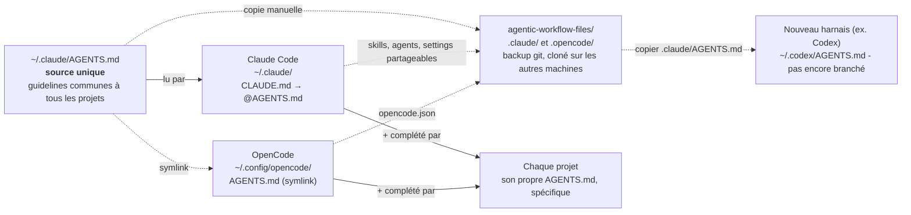

# Structure agnostique du harnais - Claude Code / OpenCode

Une seule source de vérité (`~/.claude/AGENTS.md`), lue par les deux harnais actuellement branchés dessus, sauvegardée à part.

## Légende

- **`SRC`** : le seul endroit où on édite les guidelines générales (stack, conventions, sécurité, git, hooks, skills).
- **`CC` / `OC`** : chaque harnais lit `SRC`, l'un par import, l'autre par symlink - un seul fichier, deux points de lecture. Chacun garde aussi sa propre config dans son dossier global.
- **`BACKUP`** : sauvegarde versionnée (git), lue par aucun harnais et **sans lien vivant** - à resynchroniser à la main après une modif. `.claude/` contient `AGENTS.md`, les skills, les agents et un `settings.json` partageable, sans les réglages propres à la machine. `.opencode/` contient `opencode.json` et un symlink vers `.claude/AGENTS.md`.
- **`NEW`** : pour brancher un harnais supplémentaire, copier `.claude/AGENTS.md` (de ce repo, ou directement `~/.claude/AGENTS.md`) dans son dossier de config global - pas de copie dédiée à la racine du repo, une seule source à recopier à la demande.
- **`PROJ`** : un projet n'a que ses propres détails (entités, schéma, patterns) - jamais les guidelines générales, déjà chargées via `SRC`.
