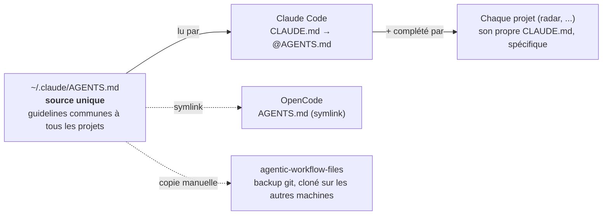

# Structure agnostique du harnais - Claude Code / OpenCode

Une seule source de vérité (`~/.claude/AGENTS.md`), lue par les deux harnais, sauvegardée à part.

## Légende

- **`SRC`** : le seul endroit où on édite les guidelines générales (stack, conventions, sécurité, git, hooks, skills).
- **`CC` / `OC`** : chaque harnais lit `SRC`, l'un par import, l'autre par symlink - un seul fichier, deux points de lecture.
- **`BACKUP`** : copie de sauvegarde versionnée (git), **pas de lien vivant** - à resynchroniser à la main après une modif de `SRC`.
- **`PROJ`** : un projet n'a que ses propres détails (entités, schéma, patterns) - jamais les guidelines générales, déjà chargées via `SRC`.
