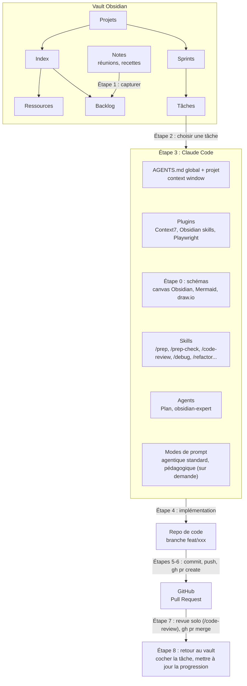

# Workflow IA - Obsidian → Claude Code → Code → PR GitHub

Ce document décrit le cycle complet utilisé pour piloter le développement d'un projet depuis un **vault Obsidian** (backlog/sprints) jusqu'à une **Pull Request GitHub**, avec **Claude Code** comme hub central (contexte, plugins, skills, agents), le **CLI Obsidian** et **`gh` CLI**.

Il complète le `AGENTS.md` global (guidelines de dev communes) + le `AGENTS.md` du projet (spécificités) et le `README.md` de ce repo (setup des skills/MCP) : ceux-ci décrivent _comment coder_, celui-ci décrit _comment on articule réunion → tâche → conception → code → PR → mise à jour du suivi_.

---

## Vue d'ensemble



Le vault Obsidian et le repo de code sont deux répertoires distincts sur la même machine. Claude Code peut passer de l'un à l'autre de deux façons :

- **Obsidian skills** (plugin `obsidian:*` - `obsidian-cli`, `obsidian-markdown`, `obsidian-bases`, `json-canvas`, `defuddle`) : ce sont les skills que Claude invoque pour lire/écrire dans le vault, y compris via le binaire CLI (`obsidian ...`, dans `~/.local/bin/obsidian`) - nécessite qu'Obsidian soit **lancé** (communication via socket local).
- **Lecture/écriture directe des fichiers** (`Read`, `Edit`, `Write`) via le chemin absolu du vault (`~/Documents/vault/...`) - toujours possible, même si Obsidian n'est pas lancé. Indispensable pour les insertions précises **sous un sous-titre donné**, que le CLI ne gère pas (`append`/`prepend` n'agissent que sur le début/la fin du fichier entier).

> Ce workflow n'utilise pas de MCP Obsidian : les **Obsidian skills** ([kepano/obsidian-skills](https://github.com/kepano/obsidian-skills), voir `README.md`) sont un plugin de skills Claude Code qui enveloppe le CLI natif `obsidian` - c'est la seule brique utilisée ici pour interagir avec le vault.

---

## 0. Conception et schémas - Canvas Obsidian, Mermaid, draw.io

Dès qu'il faut concevoir ou expliquer une grande fonctionnalité, un flux ou une architecture (nouvelle entité complexe, refonte, intégration externe), faire un schéma plutôt que de tout décrire en texte ou d'improviser directement en code. L'outil dépend du besoin :

| Outil | Pour quoi | Où |
| --- | --- | --- |
| **Canvas Obsidian natif** (fichier `.canvas`, skill `obsidian:json-canvas`) | Conception libre avant de coder : idées, modules, liens entre eux | Vault Obsidian |
| **Mermaid** | Décrire un fonctionnement ou une architecture en texte versionné : `flowchart` pour un flux ou une grande fonctionnalité, `sequenceDiagram` pour une suite d'appels, `erDiagram` pour le schéma de la base | `docs/` de chaque projet, notes de projet, README, PR |
| **draw.io** (extension VS Code) | Diagramme de classes UML détaillé | Repo du projet |

Mermaid s'affiche directement sur GitHub et dans Obsidian. Quand il faut une image (SVG dans une page, un livrable client, une app), la générer avec [Pele](https://pele.run), la librairie de rendu Mermaid de l'équipe d'Obsidian.

1. Demander le schéma à Claude Code : « fais-moi un flowchart Mermaid de [fonctionnalité] » ou « un canvas d'architecture pour [fonctionnalité] ».
2. Itérer jusqu'à ce que la structure soit claire (entités, flux de données, séquence d'appels).
3. Une fois validé, ranger le schéma Mermaid dans `docs/` du projet (ou la note du projet) pour qu'il évolue avec le code. La conception sert de base à l'étape 1 (capture de la tâche) ou directement à l'étape 4 (implémentation) si la tâche existe déjà dans le sprint.

> Systématique pour une grande fonctionnalité ou une architecture. Pour un bugfix ou une petite feature, passer directement à l'étape 1 ou 4.
>
> Deux pièges Mermaid : un label qui contient un point doit être entre guillemets (`A["draw.io"]`), et un label qui commence par « 1. » s'affiche comme une erreur de liste Markdown.

---

## 1. Capturer les tâches depuis un point dev / une recette client (Obsidian skills)

Après une réunion (point dev interne, recette client), transformer les échanges en tâches de sprint plutôt que de les laisser dans des notes volantes :

1. **Noter à chaud** pendant/juste après la réunion, dans une note dédiée ou la note du jour :
    ```bash
    obsidian daily:append content="## Point dev 2026-07-15\n- Dev A: retirer les étapes inutiles de la synchronisation\n- Dev B: tester la modification a posteriori"
    ```
    ou une note dédiée :
    ```bash
    obsidian create name="Recette client 2026-07-15" content="- Retour client: ..." folder="Projets/Mon Projet/notes"
    ```
2. **Demander à Claude Code de structurer** : « transforme les notes de la réunion du 15/07 en tâches dans le Sprint courant ». Claude :
    - lit la note de réunion (`obsidian read file="..."` ou lecture directe) ;
    - lit le sprint courant pour repérer le bon sous-titre (ex. `#### API`) ;
    - insère les nouvelles lignes `- [ ] ...` **sous ce sous-titre précis**, via édition directe du fichier (le CLI `append` ajouterait à la fin du fichier entier, pas sous la bonne section).
3. Vérifier le résultat (`obsidian read path="Projets/<Projet>/sprints/Sprint NN.md"`) avant de passer à l'implémentation.

Les notes de réunion et les tâches ponctuelles alimentent aussi le **Backlog** du projet (`Index` → `Backlog`) - utile pour tout ce qui n'est pas encore priorisé dans un sprint actif ; l'`Index` d'un projet pointe également vers ses **Ressources** (docs, liens, comptes-rendus).

> Si `obsidian: command not found` : vérifier qu'Obsidian est ouvert et que `~/.local/bin` est dans le `PATH`. À défaut, revenir à la lecture/écriture directe des fichiers du vault (équivalente pour cet usage).

---

## 2. Suivi des tâches dans Obsidian

Chaque projet a ses sprints dans `Projets/<Projet>/sprints/Sprint NN.md`, avec un frontmatter commun :

```yaml
---
numero: 10
titre: Titre du sprint
statut: active # planifié | active | done
debut: 2026-06-18
fin: 2026-07-31
progression: 60 # % - mis à jour à la main
type: sprint
tags: [project, sprint]
---
```

Les tâches suivent le format checklist du plugin **Tasks** :

```markdown
- [ ] Tâche non faite
- [x] Tâche faite ✅ 2026-06-18
```

Quand un projet couvre plusieurs sous-thèmes (ex. Frontend / API / Intégration), les tâches sont regroupées sous des sous-titres (`#### API`) - ça permet de retrouver rapidement à quoi correspond une tâche et de filtrer par sous-projet.

**Pour demander une tâche à Claude Code** : « fais la tâche X du sprint N » → Claude ouvre `Sprint 0N.md`, repère la section correspondante et la ligne `- [ ]` associée.

---

## 3. Claude Code : le hub central

Une fois la tâche identifiée, tout se joue dans Claude Code, qui combine quatre briques :

- **Fichiers de contexte** (`AGENTS.md` global + `AGENTS.md` du projet) → chargés automatiquement dans la **context window** de la session, avant toute implémentation.
- **Plugins** → `Context7` (doc à jour des librairies), `Obsidian skills` (lecture/écriture du vault, voir Vue d'ensemble) et **Playwright** (MCP, navigateur headless scriptable - voir étape 4 pour la vérification des changements UI).
- **Skills** (`.claude/skills/<nom>/SKILL.md`) → invoqués à la demande selon le besoin, liste complète dans [Skills disponibles du `README.md`](./README.md#skills-disponibles). Le skill de revue de ce repo est `/stack-review` - à ne pas confondre avec `/code-review`, le skill **natif** de Claude Code (revue de diff générique, voir plus bas).

- **Agents personnalisés** (`.claude/agents/*.md`) → subagents avec instructions et outils dédiés, invocables via l'outil `Agent` ou automatiquement selon leur description :
    - `Plan` - agent intégré à Claude Code pour concevoir des plans d'implémentation.
    - `obsidian-expert` - agent custom inclus dans ce repo (`.claude/agents/obsidian-expert.md`), voir la section « Agents personnalisés » du `README.md`.

Deux **modes d'interaction** viennent s'ajouter par-dessus - ce ne sont pas des agents séparés, juste la façon dont la demande est formulée dans le prompt :

- **Mode agentique standard** - c'est le fonctionnement par défaut de Claude Code : que le mode Auto soit activé ou non, Claude exécute la tâche de bout en bout (recherche, édition, tests, commits) à partir de ta demande, sans configuration particulière.
- **Mode pédagogique** - sur demande explicite dans le prompt (« explique-moi », « guide-moi », « je veux comprendre par moi-même »), Claude oriente vers la solution par indices et explications plutôt que de l'implémenter directement.

### Hygiène de contexte

Le contexte se remplit vite (chaque fichier lu, chaque commande exécutée) et les performances de Claude se dégradent quand il est chargé - c'est la ressource à gérer en priorité, avant même le choix du modèle :

- **`/clear` entre deux tâches sans rapport.** Ne pas enchaîner une tâche sur une autre dans la même conversation « pour gagner du temps » - le contexte pollué par la tâche précédente dégrade la suivante.
- **Après 2 corrections ratées sur le même point, `/clear` plutôt qu'insister.** Une session avec des tentatives échouées accumulées performe moins bien qu'une session neuve avec un prompt initial qui intègre ce qu'on vient d'apprendre.
- **Subagents pour la recherche/exploration**, pas seulement pour la revue (`/code-review`). « Utilise un subagent pour investiguer comment X gère Y » garde les dizaines de fichiers lus hors du contexte principal, qui reste focalisé sur l'implémentation.
- **`/compact <instructions>`** pour un compactage ciblé (ex. `/compact garde la liste des fichiers modifiés et les commandes de test`) plutôt que de laisser l'auto-compaction générique décider seule sur une tâche longue.

---

## 4. Implémentation dans le repo de code

1. **Si la tâche est complexe** (feature non triviale, besoin flou, risque de casser la prod) : préparer avant de coder plutôt que de foncer sur un plan incomplet.
    ```
    /prep <tâche>         # doc, remise en question, angles morts (prod/edge cases/sécu), archi de base → écrit dans SPEC.md
    /prep-check <tâche>   # vérifie que SPEC.md est complet avant d'entrer en mode plan
    ```
    Une fois `/prep-check` au vert, entrer en mode plan (agent `Plan`, section 3) : le plan se construit à partir de `SPEC.md`, pas de la mémoire de la conversation - utile aussi pour repartir sur une session neuve rien que pour l'implémentation (section « Hygiène de contexte » ci-dessus). Pour une tâche simple, passer directement à l'étape suivante.

2. Se placer sur la branche principale de dev du repo (`develop` ou `main` selon le projet) et créer une branche dédiée, avec le nommage défini dans `AGENTS.md` (section Conventions Git) :

    ```bash
    git checkout -b feat/nom-de-la-feature
    ```

3. Implémenter en suivant `AGENTS.md` (stack, conventions, tests) et le `AGENTS.md` du projet (spécificités).
4. Vérifier avant de committer : tests, lint, exécution locale - et pour tout changement **UI/frontend**, passage réel dans un navigateur via le **MCP Playwright** (parcours nominal + cas limites, pas seulement la compilation/les tests unitaires qui ne garantissent pas le comportement visuel).

---

## 5. Commit & Push (manuel ou délégué à Claude)

Pas de hook configuré sur ce repo : le commit/changelog/push n'est **pas automatisé** par un mécanisme du harnais (voir note plus bas sur les hooks). Deux façons équivalentes de faire, selon le moment :

- **À la main** : tu tapes toi-même les commandes `git`/`gh`.
- **Via prompt à Claude** : tu demandes « commit et push cette modif » et Claude exécute les mêmes commandes, en respectant les règles ci-dessous.

Les règles de commit sont **celles définies dans `AGENTS.md`** (section Conventions Git - format Conventional Commits, message en anglais, une responsabilité par commit, jamais de `Co-Authored-By: Claude`) - que ce soit toi ou Claude qui committe, ce sont les mêmes.

```bash
git add <fichiers>
git commit -m "feat(auth): add password reset via email"
git push -u origin feat/nom-de-la-feature
```

> **Envie d'une vraie automatisation ?** La section « Hooks (à configurer par projet) » de `AGENTS.md` documente un hook `PostToolUse` prêt à copier (typecheck backend + lint frontend après chaque edit) - déterministe, contrairement à une règle `AGENTS.md` que Claude peut zapper si le contexte est chargé. Un `Stop` en fin de session (rappel de commit) reste à faire au cas par cas. Voir le skill `update-config` pour la mise en place.

---

## 6. Pull Request avec `gh` CLI

Le titre de la PR suit la même convention que les commits (`type(scope): description`, en anglais), pour rester cohérent avec l'historique Git :

```bash
gh pr create --title "feat(auth): add password reset via email" --body "$(cat <<'EOF'
## Summary
- ...

## Test plan
- [ ] ...
EOF
)"
```

---

## 7. Revue de la PR (dev solo)

Pas de reviewer tiers humain sur ce workflow : **c'est le développeur qui fait la revue lui-même**, assisté par Claude Code, avant de merger. Ne pas sauter cette étape sous prétexte d'être seul sur le projet - c'est justement ce qui remplace la revue par les pairs.

1. Lancer une revue automatisée sur la branche de la PR : `/code-review` (skill natif Claude Code - bugs, cohérence, sécurité).
2. Traiter les findings : corriger ce qui est bloquant, committer les corrections (nouveau commit, toujours Conventional Commits - pas d'amend sur un commit déjà pushé sans raison explicite).
3. Relire soi-même le diff final (`gh pr diff` ou l'interface GitHub) avant de merger.
4. Merger :
    ```bash
    gh pr merge --squash   # ou la stratégie de merge retenue pour le repo
    ```

---

## 8. Boucler : cocher la tâche dans Obsidian

Une tâche n'est considérée **terminée** que lorsque :

1. La PR est revue (étape 7) et mergée.
2. La checkbox correspondante dans le Sprint Obsidian est cochée avec sa date :
    ```markdown
    - [x] Tâche faite ✅ 2026-07-13
    ```
    ```bash
    obsidian task path="Projets/<Projet>/sprints/Sprint NN.md" line=<n> done
    ```

Ne pas oublier cette dernière étape - c'est elle qui garde le vault Obsidian comme source de vérité à jour sur l'avancement réel du sprint (`progression` du frontmatter à ajuster en conséquence, et `statut: done` quand toutes les tâches du sprint sont traitées ou reportées au sprint suivant).

---

## Résumé express

| Étape | Où                           | Action                                                                                                  |
| ----- | ---------------------------- | ------------------------------------------------------------------------------------------------------- |
| 0     | Claude Code (canvas, Mermaid, draw.io) | Schéma de la fonctionnalité ou de l'architecture : canvas pour concevoir, Mermaid dans `docs/` pour documenter, draw.io pour les classes |
| 1     | Réunion → Vault Obsidian     | Capturer les notes (`obsidian daily:append`/`create`), en extraire des tâches sous le bon sous-titre    |
| 2     | Vault Obsidian               | Repérer une tâche `- [ ]` dans le sprint courant                                                        |
| 3     | Claude Code                  | Contexte (`AGENTS.md`), plugins (Context7, Obsidian skills), skills et agents mobilisés selon le besoin |
| 4     | Repo de code                 | Préparer si complexe (`/prep`→`/prep-check`→plan), créer une branche, implémenter, tester                |
| 5     | Repo de code                 | Commit (manuel ou via prompt Claude, Conventional Commits, anglais, sans `Co-Authored-By`) + push       |
| 6     | GitHub (`gh` CLI)            | `gh pr create`                                                                                          |
| 7     | Repo de code / GitHub        | Revue solo dev (`/code-review`) puis `gh pr merge`                                                      |
| 8     | Vault Obsidian               | Cocher la tâche `- [x] ... ✅ date`, mettre à jour `progression`/`statut`                               |
